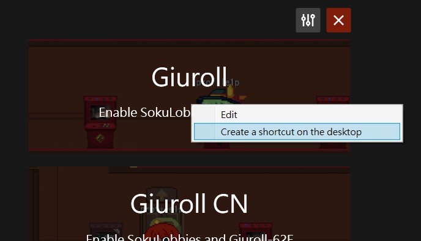
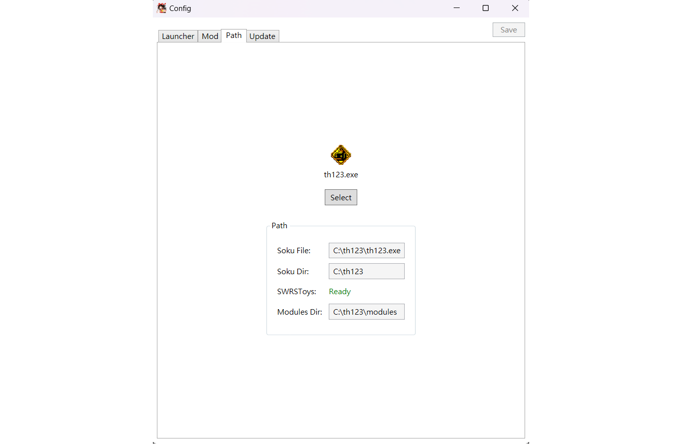
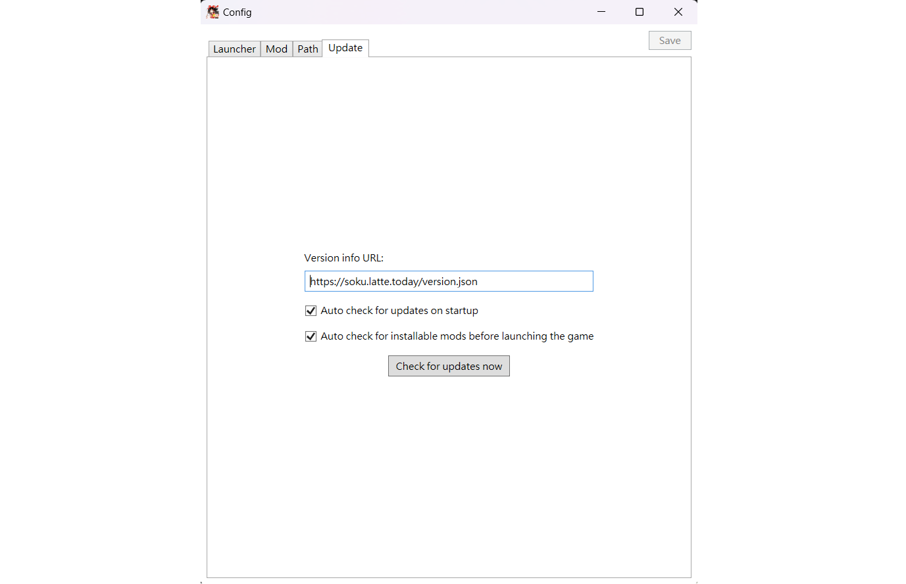

# SokuLauncher

  
  
在启动游戏前配置模组 (SWRSToys)，并提供模组自动更新及缺失模组下载功能。  

### 启动并应用模组配置
只需点击一下，SokuLauncher 即可自动切换模组并启动游戏。  

### 自动安装缺失模组
启动前如果检测到缺失模组，将弹出下载并安装模组的提示。

### 桌面快捷方式
创建桌面快捷方式图标，可快速开启指定的模组设置，且通过快捷方式启动时依然会执行自动更新检查。

## 安装
下载 SokuLauncher 并将其放置在 th123 的主目录下。  

*如果您使用的是 32 位操作系统，请将 SokuLauncher 放置在 th123 主目录的 ``父目录`` 或 ``子目录`` 中。   
或者，您也可以将其放置在其他位置，并在配置中设置 th123 可执行文件的位置。*

## 配置
### 自定义启动器
您可以自定义启动器的外观，并配置启动时启用哪些模组。  

  
### 模组
在此页面可以开启/关闭模组或删除模组。

  
### 游戏启动路径
您可以在此处设置游戏可执行文件的位置。  
如果您没有将 SokuLauncher 放置在 th123 文件夹附近，则必须进行此设置。

  
### 更新
版本信息源及相关的更新选项。
SokuLauncher 提供模组的自动更新和缺失安装。如果您不需要这些功能，也可以在此处将其禁用。

